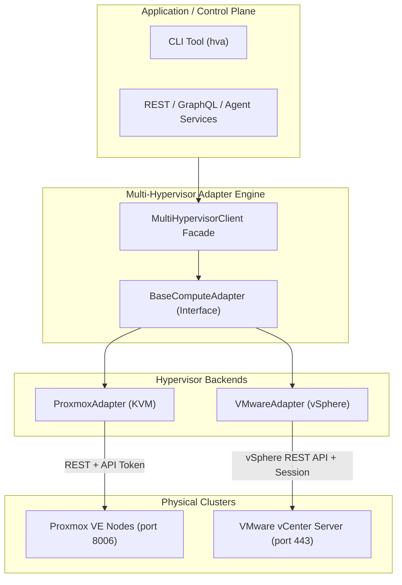

# Multi-Hypervisor Adapter

[](LICENSE)
[](https://www.python.org/downloads/)
[](https://github.com/psf/black)

A unified, lightweight compute adapter for orchestrating virtual machines across **Proxmox VE (KVM)** and **VMware vCenter (vSphere)** using their native REST APIs.

Designed for sovereign enterprise cloud architectures, multi-cloud platforms, and hybrid infrastructure management.

---

## Architecture Overview



---

## Features

* **Unified Abstraction Layer:** Single interface (`list_vms`, `get_vm`, `start_vm`, `stop_vm`, `restart_vm`, `create_vm`, `resize_vm`, `delete_vm`).
* **Proxmox VE (KVM) Integration:**
  * Uses the Proxmox 8.x JSON REST API (`https://<host>:8006/api2/json`).
  * Supports non-expiring **API Token Authentication** (`PVEAPIToken=USER@REALM!TOKENID=UUID`) and ticket auth.
  * Native **Cloud-Init** injection (SSH public keys, default user, static IP/CIDR, gateway).
  * Fast template cloning (full or linked clones) and disk/storage pool selection.
  * Live hardware hotplug / resizing (`cores`, `memory`).
* **VMware vCenter (vSphere) Integration:**
  * Native vSphere 7.0 / 8.0 REST API (`https://<vcenter-host>/api`).
  * Automatic **Session Token** management with transparent re-login on token expiration.
  * Direct hardware patching (`/hardware/cpu`, `/hardware/memory`).
  * Graceful guest OS shutdown/reboot with automatic fallback to hard power-off.
* **Multi-Cluster Client:** Register multiple heterogeneous clusters and query or manipulate VMs with a single client.
* **CLI Included:** Comes with the `hva` command-line tool for immediate terminal management.

---

## Installation

```bash
git clone https://github.com/DeveshB-1/multi-hypervisor-adapter.git
cd multi-hypervisor-adapter
pip install .
```

Or using `uv`:
```bash
uv pip install -e .
```

---

## Quickstart

### 1. Using the Multi-Cluster Client

```python
from hypervisor_adapter import (
    MultiHypervisorClient,
    ProxmoxAdapter,
    VMwareAdapter,
    VMCreateRequest,
    VMResizeRequest,
)

client = MultiHypervisorClient()

# Register Proxmox Cluster (Token-based)
client.register(
    "kvm-zone-a",
    ProxmoxAdapter(
        endpoint="https://pve-cluster.internal:8006",
        token_id="root@pam!swaraj_token",
        token_secret="11111111-2222-3333-4444-555555555555",
        verify_ssl=False,
    ),
)

# Register VMware Cluster (Credential-based)
client.register(
    "vmware-zone-b",
    VMwareAdapter(
        endpoint="https://vcenter.internal",
        username="administrator@vsphere.local",
        password="YourPasswordHere",
        verify_ssl=False,
    ),
)

# List all VMs across all clusters uniformly
for vm in client.list_vms():
    print(f"[{vm.hypervisor.value.upper()}] ID={vm.vm_id} | Name={vm.name} | Status={vm.status.value}")

# Power on a VM in Proxmox
client.start_vm("kvm-zone-a", "105")

# Resize CPU/RAM in VMware
client.resize_vm("vmware-zone-b", "vm-2048", VMResizeRequest(cpu_cores=8, memory_mb=16384))
```

---

### 2. Standalone Proxmox Deployment with Cloud-Init

```python
from hypervisor_adapter import ProxmoxAdapter, VMCreateRequest

adapter = ProxmoxAdapter(
    endpoint="https://10.10.10.100:8006",
    token_id="root@pam!token",
    token_secret="your-token-secret",
    verify_ssl=False,
)

# Clone template (vmid 9000) and configure with Cloud-Init
req = VMCreateRequest(
    name="prod-web-01",
    template_id="9000",
    cpu_cores=4,
    memory_mb=8192,
    cloud_init_user="ubuntu",
    cloud_init_ssh_key="ssh-ed25519 AAAAC3NzaC1lZDI1NTE5AAAAIG... user@swaraj",
    ip_cidr="10.10.1.50/24",
    gateway="10.10.1.1",
    storage_pool="local-lvm",
)

result = adapter.create_vm(req)
print(f"Task ID: {result.task_id}, VM ID: {result.vm_id}")
```

---

## CLI Usage

The package ships with `hva` (HyperVisor Adapter):

```bash
# Set environment variables
export HYPERVISOR_ENDPOINT="https://pve1.internal:8006"
export PROXMOX_TOKEN_ID="root@pam!token"
export PROXMOX_TOKEN_SECRET="xxxx-xxxx-xxxx"

# List virtual machines
hva list --type proxmox

# Start / Stop a VM
hva start --type proxmox 100
hva stop --type proxmox 100 --force

# Resize CPU/RAM
hva resize --type proxmox 100 --cpu 4 --ram 8192

# Query single VM in JSON
hva get --type proxmox 100
```

---

## Running Tests

```bash
uv run --with pytest pytest tests/ -v
```

---

## License

MIT License. Copyright (c) 2026 Devesh B.
